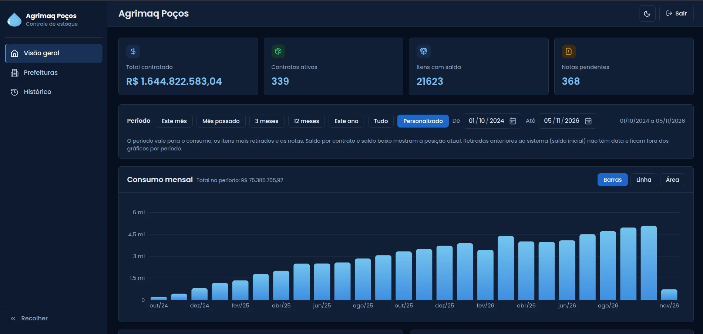
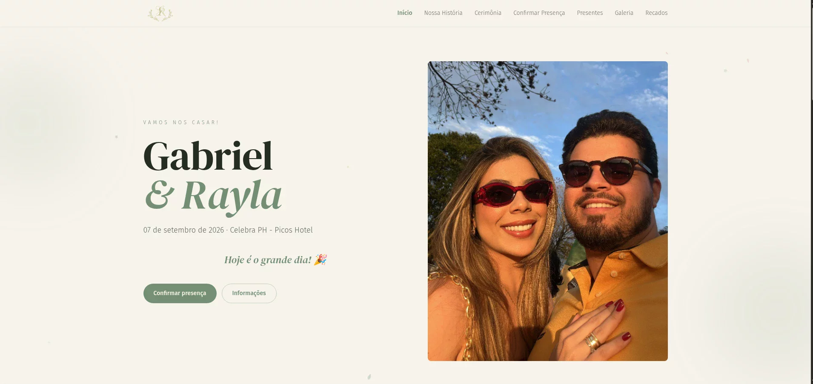
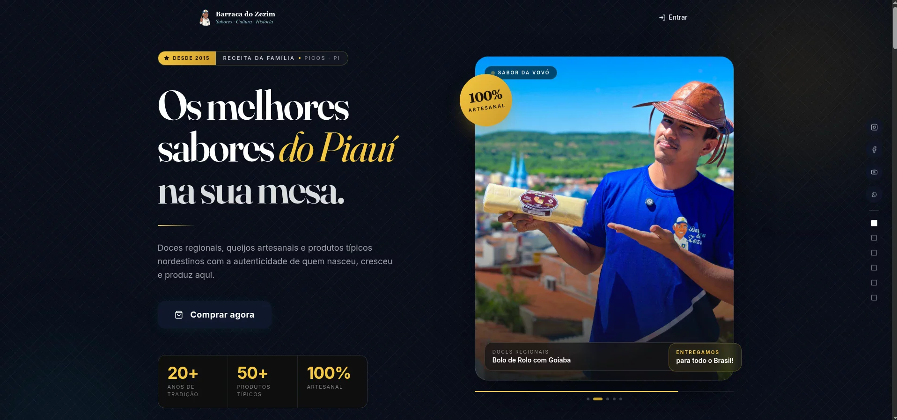
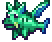

**Turning ideas into digital solutions.**

Freelance developer · Information Systems student @ UFPI

---

### About me

I'm Mayan, an Information Systems student at the **Federal University of Piauí (UFPI)**, Picos campus, and a **freelance developer** building digital solutions for people and businesses.

I like to understand the problem before writing the code, and I take projects from the first conversation all the way to implementation. My main interests are **backend development, application architecture, web development and building digital products**.

- 🎓 Information Systems @ UFPI
- 💼 Freelance web development
- 🧠 Backend, architecture and digital products
- 🥁 Fun fact: I play drums in my spare time

---

### Featured work

These are client projects, so the repositories are private. Here is what they look like:

<table>
  <tr>
    <td width="50%" valign="top">
      
    </td>
    <td width="50%" valign="top">
      <h4>Bid Management System · Agrimaq</h4>
      
Bid management system for Agrimaq: contracts with city halls, consumption, balances and invoices on one dashboard, plus PDF reports.

      
<code>React</code> <code>Vite</code> <code>Supabase</code> <code>PostgreSQL</code> <code>Cloudflare</code> <code>Docker</code>

    </td>
  </tr>
  <tr>
    <td width="50%" valign="top">
      
    </td>
    <td width="50%" valign="top">
      <h4>G &amp; R Wedding Website</h4>
      
Custom wedding website focused on the visual experience: animations, event information and a photo gallery.

      
<code>React</code> <code>Vite</code> <code>Tailwind CSS</code> <code>Framer Motion</code> <code>Lenis</code> <code>Supabase</code>

    </td>
  </tr>
  <tr>
    <td width="50%" valign="top">
      
    </td>
    <td width="50%" valign="top">
      <h4>Barraca do Zezim · E-commerce</h4>
      
Online store for a local business, from catalog to checkout, with Mercado Pago payments and Melhor Envio shipping quotes.

      
<code>React</code> <code>Vite</code> <code>Tailwind CSS</code> <code>Supabase</code> <code>Mercado Pago</code> <code>Melhor Envio</code>

    </td>
  </tr>
</table>

---

### Tech stack

**Frontend** 

**Backend** 

**Data & infra** 

**Tools** 

---

### From university

Public coursework in other paradigms and languages:

- [**Thread concurrency simulation**](https://github.com/mayandev1/Simulacao-de-Concorrencia-com-Threads-SO) · Go · Operating Systems
- [**Decision support system for respiratory diseases**](https://github.com/mayandev1/decision-support-system-for-respiratory-diseases-prolog) · Prolog
- [**Functional programming project**](https://github.com/mayandev1/Trabalho-Progamacao-Funcional) · Haskell
- [**Data Structures I**](https://github.com/mayandev1/Estrutura-de-Dados-I) · C

---

### Let's talk

<a href="https://www.linkedin.com/in/mayan-gabriel/">LinkedIn</a> &nbsp;•&nbsp;
<a href="https://www.instagram.com/mayangmz/">Instagram</a> &nbsp;•&nbsp;
<a href="mailto:mayandev01@gmail.com">mayandev01@gmail.com</a>

<!-- Add the portfolio link here after the deploy. -->

   
  
   
  Code and be strong.

